# 📱 Google Play Store Data Analysis

### Exploratory Data Analysis | Python | Pandas | NumPy | Matplotlib | Seaborn

## 📌 Project Overview

This project focuses on analyzing Google Play Store applications and user reviews to understand app performance, ratings, installations, pricing, category trends, and customer sentiment.

The objective is to transform raw application and review data into meaningful insights that help identify patterns in app performance, understand customer feedback, and support data-driven business decisions.

The project follows an end-to-end exploratory data analysis (EDA) workflow, including data cleaning, preprocessing, statistical analysis, visualization, and customer review analysis.

---

## 🎯 Project Objectives

- Analyze the distribution of application ratings.
- Compare free and paid applications.
- Identify the most installed applications.
- Explore app categories and their average ratings.
- Investigate the relationship between app size and installations.
- Analyze paid application prices.
- Examine the relationship between ratings and installations.
- Perform sentiment analysis on customer reviews.
- Identify frequently occurring words in user reviews.
- Explore the most helpful user reviews.
- Identify common topics in negative reviews.
- Develop actionable business insights and recommendations.

---

## 🛠️ Tools and Technologies

| Technology | Purpose |
|---|---|
| Python | Data analysis and programming |
| Pandas | Data cleaning and manipulation |
| NumPy | Numerical operations |
| Matplotlib | Data visualization |
| Seaborn | Statistical visualization |
| Jupyter Notebook | Interactive analysis |
| Git | Version control |
| GitHub | Project hosting and portfolio development |

---

## 📂 Project Structure

```text
Oasis_Google_Play_Store_Analysis/
│
├── data/
│   ├── googleplaystore.csv
│   ├── reviews.csv
│   └── reviews_clean.csv
│
├── images/
│   ├── app_rating_distribution.png
│   ├── app_size_vs_installs.png
│   ├── app_type_distribution.png
│   ├── negative_review_topics.png
│   ├── paid_app_price_distribution_under_50.png
│   ├── paid_app_price_distribution.png
│   ├── rating_vs_installs.png
│   ├── review_sentiment_distribution.png
│   ├── top_10_app_categories.png
│   ├── top_10_categories_by_rating.png
│   ├── top_10_most_helpful_reviews.png
│   ├── top_10_most_installed_apps.png
│   └── top_15_review_words.png
│
├── notebooks/
│   ├── 01_google_play_store_analysis.ipynb
│   └── 02_google_play_store_eda.ipynb
│
├── .gitignore
├── requirements.txt
└── README.md
```

---

## 📊 Dataset Description

This project uses two datasets for application analysis and customer review analysis.

### 1. Google Play Store Dataset

File: `googleplaystore.csv`

The dataset contains application information, including fields such as:

- App name
- Category
- Rating
- Number of reviews
- App size
- Number of installations
- App type
- Price
- Content rating
- Genres

### 2. User Reviews Dataset

File: `reviews.csv`

The review dataset contains user feedback and related information, such as:

- Review ID
- User name
- Review content
- Review score
- Thumbs-up count
- Review date
- App version information

### 3. Cleaned User Reviews Dataset

File: `reviews_clean.csv`

This dataset is used for review analysis after preprocessing.

The exact columns and cleaning operations depend on the data preparation implemented in the notebooks.

---

## 🔍 Project Workflow

### Phase 1: Data Loading and Inspection

- Loaded the datasets using Pandas.
- Examined dataset dimensions and column names.
- Inspected data types and missing values.
- Reviewed sample records.

### Phase 2: Data Cleaning and Preprocessing

- Handled missing and invalid values.
- Converted relevant columns to appropriate data types.
- Cleaned numerical fields.
- Prepared datasets for analysis.

### Phase 3: Exploratory Data Analysis

Analyzed application performance through:

- Rating distribution.
- Free versus paid app distribution.
- App category analysis.
- Most installed applications.
- App size versus installations.
- Paid application price distribution.
- Average ratings by category.

### Phase 4: Relationship Analysis

Investigated the relationship between application ratings and installations using scatter plots and correlation analysis.

### Phase 5: Customer Review Analysis

Explored user feedback through:

- Sentiment distribution.
- Frequently used review words.
- Most helpful user reviews.
- Common topics in negative reviews.

### Phase 6: Business Insights

Interpreted the analytical results and developed recommendations based on application performance and customer feedback.

---

# 📈 Key Visualizations

## 1. App Rating Distribution

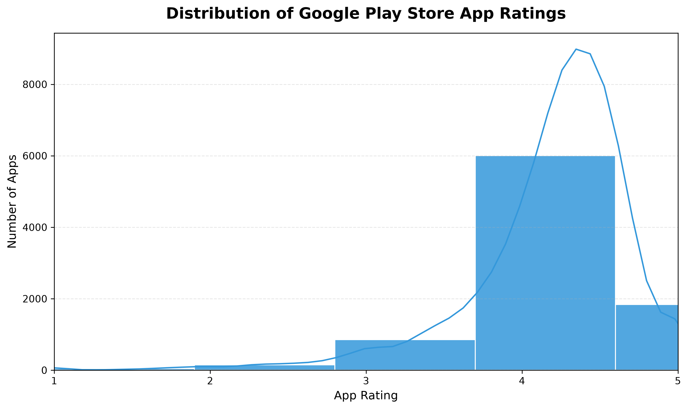

Examines how application ratings are distributed across the dataset.

## 2. App Size vs. Installations

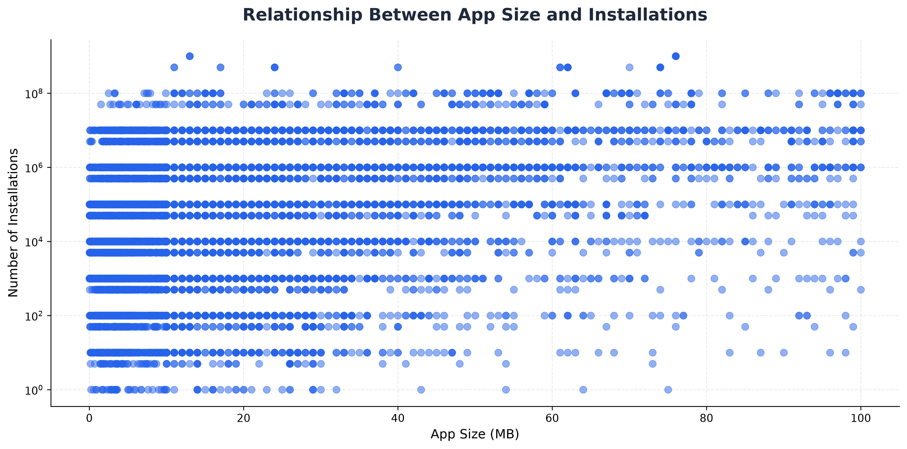

Explores installation patterns across different application sizes.

## 3. Free vs. Paid Applications

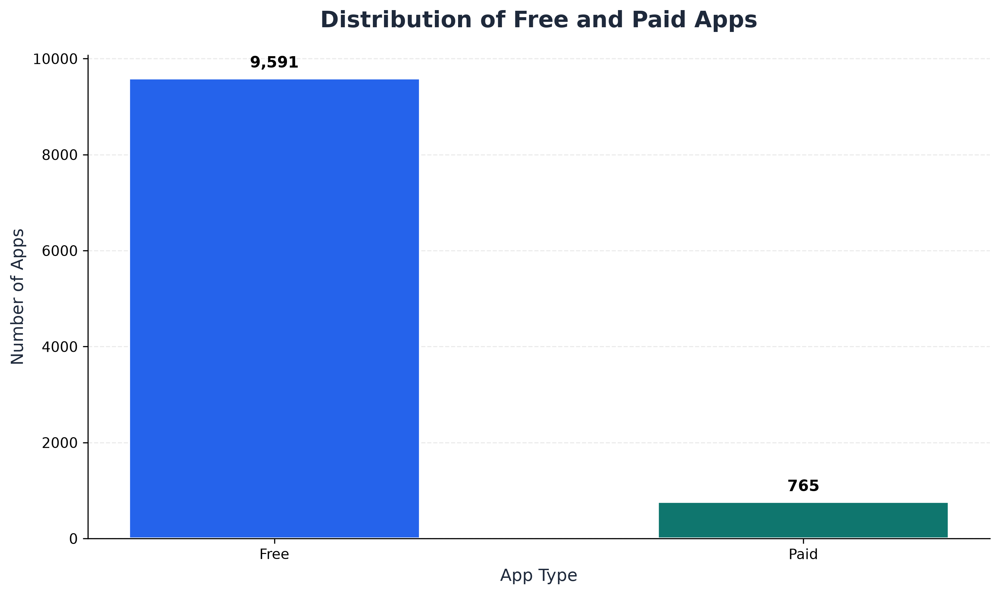

Compares the distribution of free and paid applications.

## 4. Relationship Between App Ratings and Installations

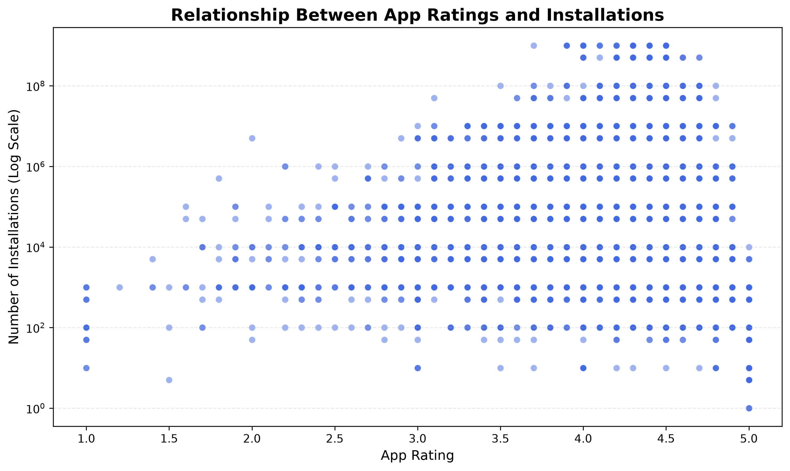

Examines the relationship between ratings and installation counts.

## 5. Paid App Price Distribution

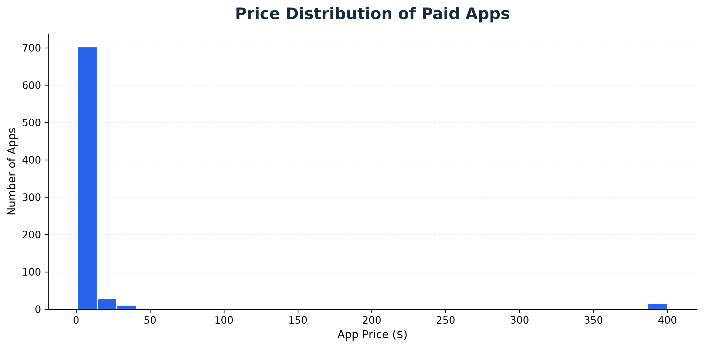

Explores the distribution of prices among paid applications.

## 6. Paid App Prices Below 50

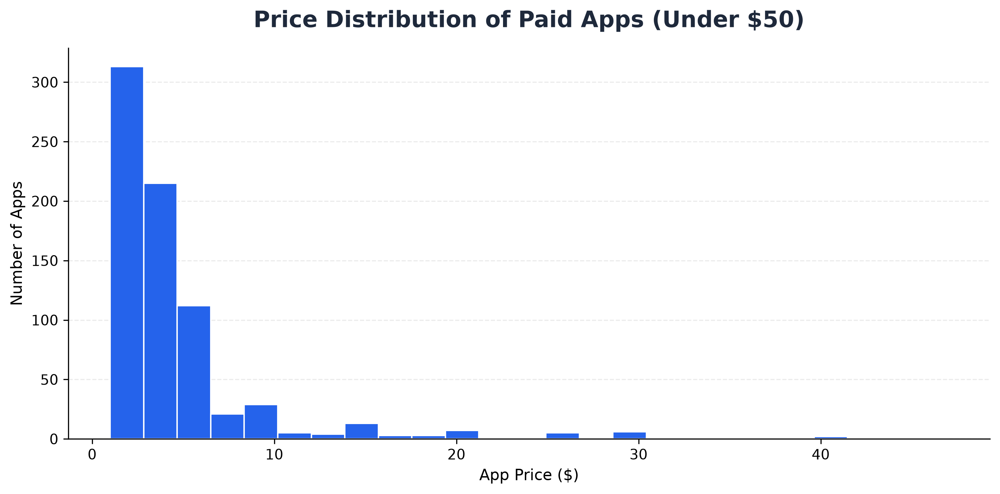

Provides a closer look at the price distribution for paid applications priced below 50, using the filtering criteria applied in the analysis.

## 7. Top 10 App Categories

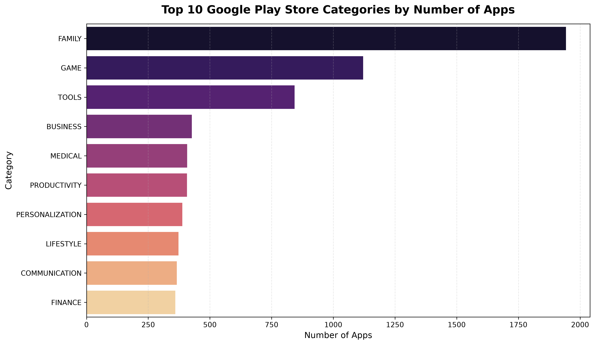

Presents the leading app categories identified by the corresponding analysis.

## 8. Top Categories by Average Rating

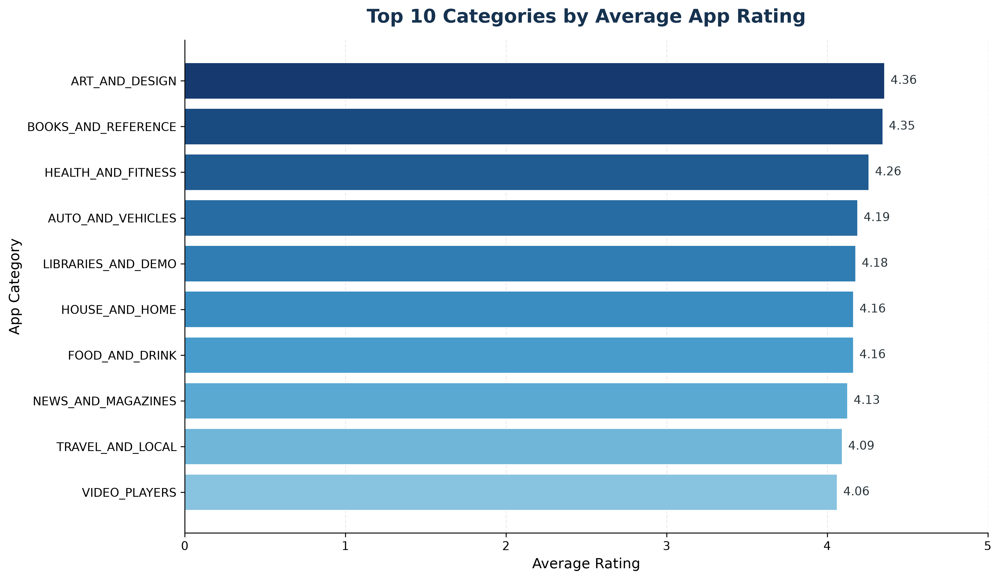

Compares average application ratings across selected categories.

## 9. Most Installed Applications

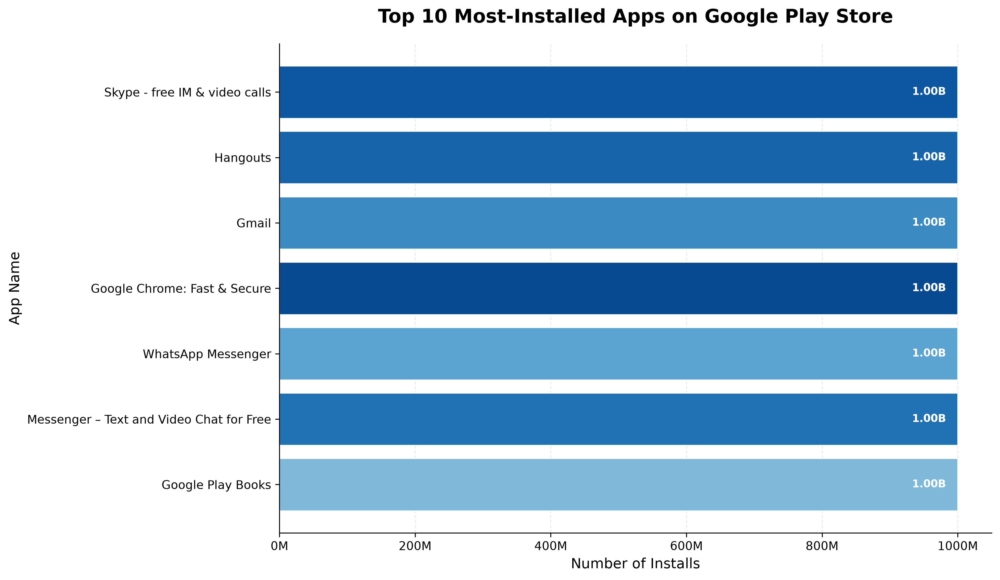

Highlights applications with the highest installation counts in the analyzed dataset.

## 10. User Review Sentiment Distribution

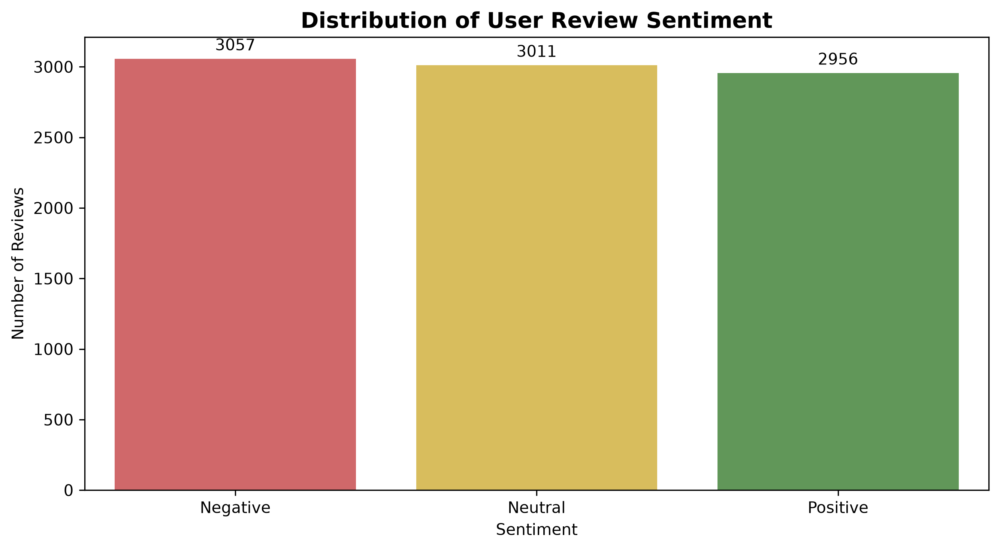

Displays the distribution of negative, neutral, and positive user reviews.

## 11. Most Helpful User Reviews

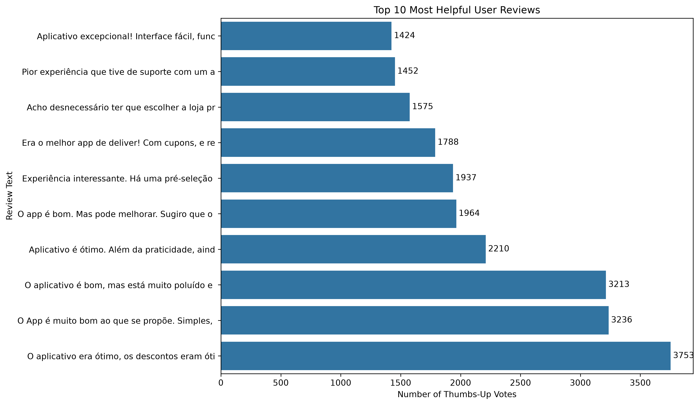

Highlights reviews with high thumbs-up counts.

## 12. Most Frequent Words in User Reviews

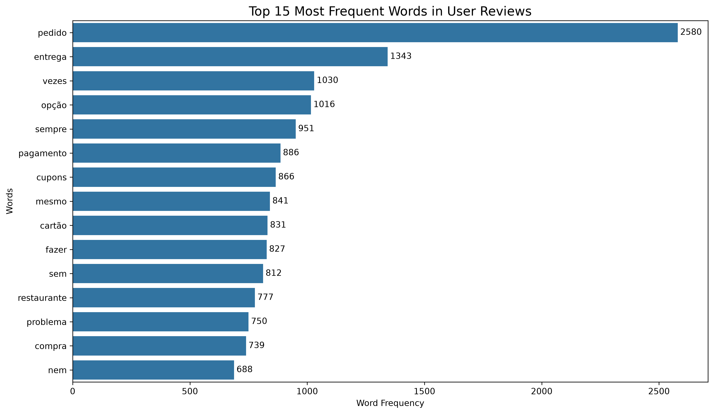

Identifies frequently occurring words in customer reviews.

## 13. Common Topics in Negative Reviews

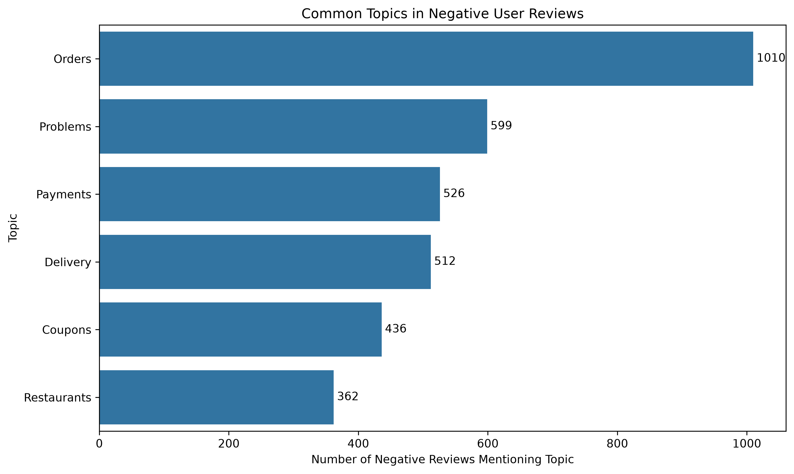

Highlights common topics identified in negative customer reviews.

---

## ❓ Business Questions Answered

This project investigates the following questions:

1. How are application ratings distributed?
2. What is the distribution of free and paid apps?
3. Which applications have the highest installation counts?
4. Which app categories have high average ratings?
5. Is there a relationship between app ratings and installations?
6. How does app size relate to installation counts?
7. How are paid app prices distributed?
8. What is the distribution of sentiment in customer reviews?
9. Which words occur most frequently in user reviews?
10. Which reviews receive the most thumbs-up votes?
11. What topics frequently appear in negative reviews?
12. How can customer feedback help identify opportunities for improvement?

---

## 💡 Key Findings

### 1. Ratings and Installations

The calculated correlation between app ratings and installations was approximately **0.051** in the analyzed data.

This indicates a very weak linear relationship between the two variables. App ratings alone do not explain installation counts.

### 2. Review Sentiment

The sentiment analysis produced the following results:

| Sentiment | Number of Reviews |
|---|---:|
| Negative | 3,057 |
| Neutral | 3,011 |
| Positive | 2,956 |

The distribution is relatively balanced, with negative reviews slightly outnumbering positive reviews.

### 3. Common Topics in Negative Reviews

The negative review topic analysis produced the following counts:

| Topic | Number of Reviews Mentioning Topic |
|---|---:|
| Orders | 1,010 |
| Problems | 599 |
| Payments | 526 |
| Delivery | 512 |
| Coupons | 436 |
| Restaurants | 362 |

These counts depend on the topic-identification method used. Topics may overlap, and the results should be interpreted in the context of the analyzed review dataset.

### 4. App Category Performance

The category analysis compares average ratings to identify categories with highly rated applications.

Average ratings should also be considered alongside the number of apps and reviews in each category.

### 5. Customer Feedback

Frequently occurring words and helpful reviews provide additional context about customer experiences and possible areas for improvement.

---

## 🎯 Business Recommendations

### 1. Investigate Customer Complaints

Examine recurring order-related complaints to identify their underlying causes.

### 2. Improve Payment Reliability

Investigate payment-related feedback to identify possible transaction failures or usability issues.

### 3. Evaluate Delivery and Coupon Experiences

Where applicable, review delivery issues and coupon-related complaints to identify opportunities for improvement.

### 4. Monitor Customer Sentiment

Track ratings and review sentiment over time to evaluate whether product improvements positively affect customer experience.

### 5. Evaluate App Performance Holistically

Consider ratings, installations, review counts, category, and other relevant factors together rather than relying on one metric.

### 6. Use Customer Reviews for Product Improvement

Combine review analysis with manual inspection of customer feedback to prioritize important issues.

---

## ⚙️ How to Run the Project

### Prerequisites

- Python
- Visual Studio Code or Jupyter Notebook
- Git

### Step 1: Clone the Repository

```bash
git clone YOUR_GITHUB_REPOSITORY_URL
```

Replace `YOUR_GITHUB_REPOSITORY_URL` with your actual GitHub repository URL.

### Step 2: Navigate to the Project Folder

```bash
cd Oasis_Google_Play_Store_Analysis
```

### Step 3: Create a Virtual Environment

```bash
python -m venv .venv
```

### Step 4: Activate the Environment

On Windows:

```bash
.venv\Scripts\activate
```

### Step 5: Install Dependencies

```bash
pip install -r requirements.txt
```

### Step 6: Open the Notebooks

Open the `notebooks` folder in VS Code and run:

- `01_google_play_store_analysis.ipynb`
- `02_google_play_store_eda.ipynb`

Run the notebook cells in order.

Ensure the dataset paths match the project's folder structure.

---

## 📦 Requirements

The `requirements.txt` file should include the libraries required by the notebooks.

Typical dependencies include:

```text
pandas
numpy
matplotlib
seaborn
jupyter
ipykernel
```

Include any additional libraries imported by your actual code.

---

## 🚀 Future Improvements

Potential improvements include:

- Advanced sentiment analysis using pretrained NLP models.
- More detailed customer review topic modeling.
- Statistical testing to investigate relationships between variables.
- An interactive dashboard using Power BI or Streamlit.
- Deeper analysis of app category performance.
- Automated reporting of customer review trends.

These are possible extensions and are not claimed as completed features.

---

## 🧠 Skills Demonstrated

- Data cleaning and preprocessing.
- Exploratory data analysis.
- Numerical analysis.
- Correlation analysis.
- Data visualization.
- Customer review analysis.
- Sentiment analysis.
- Business insight generation.
- Python programming.
- Jupyter Notebook documentation.
- Git and GitHub.

---

## 👩‍💻 Author

**Mamta Chaudhary**

BSc Data Science & Artificial Intelligence

Interested in **Data Analytics, Business Intelligence, Machine Learning, and Data Science**.

### Connect with me

📧 **Email:** choudharymamta1003@gmail.com

💼 **LinkedIn:** https://www.linkedin.com/in/mamta-chaudhary-964128353/

---

⭐ If you find this project useful, consider giving the repository a star!

**Data Science and Artificial Intelligence Student**

This project was developed as part of my data analytics learning and portfolio development journey.

---

## ⭐ Conclusion

The Google Play Store Data Analysis project demonstrates an end-to-end exploratory data analysis workflow, from data inspection and cleaning to application performance analysis and customer review exploration.

The findings provide a foundation for understanding application trends, identifying potential customer concerns, and supporting data-driven recommendations.

If you find this project useful, feel free to explore the notebooks and visualizations.
